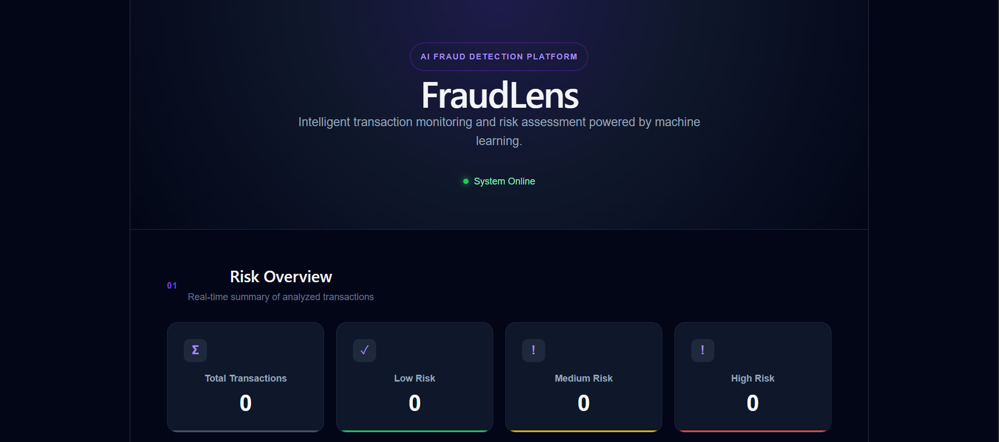

# FraudLens — AI-Powered Financial Fraud Detection & Risk Analysis

FraudLens is a full-stack machine learning application that analyzes financial transactions, estimates fraud probability, and converts model predictions into easy-to-understand risk assessments through an interactive dashboard.

The project combines a Random Forest classifier, Python, FastAPI, React, and SQLite to demonstrate an end-to-end machine learning application.

## 🚀 Live Demo

- **Live Dashboard:** https://trust-ledger-b3k2.vercel.app
- **Backend API:** https://trust-ledger-ivory.vercel.app
- **GitHub Repository:** https://github.com/maulele2006/TrustLedger

> The application is deployed under its original TrustLedger URL. The project branding has been updated to FraudLens.

## 🖥️ Dashboard Preview



FraudLens provides a dashboard for transaction analysis, model evaluation, risk assessment, and transaction history.

## ✨ Features

- **Fraud Detection:** Analyze transaction features using a trained Random Forest classifier.
- **Fraud Probability:** Display the model's estimated probability that a transaction is fraudulent.
- **Trust Score:** Convert fraud probability into a complementary score out of 100.
- **Risk Classification:** Categorize predictions into Low, Medium, and High risk.
- **Transaction Analysis:** Select sample transactions and run predictions through the backend API.
- **Transaction History:** Display previously analyzed transactions, with browser-based persistence in the deployed dashboard.
- **Model Performance:** Display Accuracy, Precision, Recall, F1-score, and ROC-AUC.
- **Model Comparison:** Compare Random Forest with Logistic Regression.
- **Feature Importance:** Display the most influential features reported by the Random Forest model.
- **Transaction Analytics:** Visualize risk distribution, fraud versus normal transactions, and a confusion matrix.
- **REST API:** Connect the frontend to the machine learning model through FastAPI.

## 🛠️ Technology Stack

| Component | Technology |
|---|---|
| Frontend | React, JavaScript, CSS |
| Backend | Python, FastAPI |
| Machine Learning | Scikit-learn, Random Forest |
| Data Processing | Pandas |
| Model Storage | Joblib |
| Database | SQLite |
| Deployment | Vercel |
| Version Control | Git and GitHub |

## 🧠 Machine Learning

FraudLens uses a Random Forest classifier trained on the Credit Card Fraud Detection dataset.

### Dataset

The original dataset contains:

- **284,807 transactions**
- **492 fraudulent transactions**
- **30 input features**
- A highly imbalanced distribution between normal and fraudulent transactions

The dataset includes the following columns:

- `Time`
- `V1` through `V28`
- `Amount`
- `Class` — target label, where `0` represents normal transactions and `1` represents fraudulent transactions

The deployed application loads sample transactions for demonstration. The original dataset is used for model training and evaluation.

### Model Workflow

1. Load transaction features.
2. Validate that all required model features are present.
3. Pass the features to the trained Random Forest classifier.
4. Obtain the predicted fraud probability.
5. Calculate the trust score as the complement of the fraud probability.
6. Assign a risk category based on the trust score.
7. Return the prediction to the React dashboard.
8. Display the result and transaction history.

### Risk Classification

The current application uses these thresholds:

| Trust Score | Risk Level |
|---|---|
| 80–100 | Low |
| 50–79.99 | Medium |
| Below 50 | High |

The trust score is calculated as:

`Trust Score = (1 − Fraud Probability) × 100`

These are application-defined thresholds, not universal financial risk standards.

## 📊 Model Evaluation

The dashboard displays the following evaluation metrics:

- **Accuracy:** Overall proportion of correct predictions.
- **Precision:** Proportion of predicted fraud cases that are actually fraudulent.
- **Recall:** Proportion of actual fraud cases correctly detected.
- **F1-score:** Harmonic mean of precision and recall.
- **ROC-AUC:** Measures how well the model distinguishes between the two classes across classification thresholds.

The project includes a model evaluation module and a model comparison endpoint.

> Evaluation figures should be interpreted using the actual held-out test results from the current trained model. Accuracy alone can be misleading for an imbalanced fraud detection dataset.

## 🏗️ System Architecture

```text
                  React Frontend
                        |
                        v
                    FastAPI
                        |
                        v
              Transaction Validation
                        |
                        v
              Random Forest Model
                        |
                        v
              Fraud Probability
                        |
                        v
               Trust Score & Risk
                        |
                        v
                 Dashboard UI
                        |
                        v
                Transaction History
```

The frontend communicates with the FastAPI backend through HTTP requests. The backend loads the trained model and sample dataset, generates predictions, and exposes endpoints for analytics and model information.

## 🔌 API Endpoints

| Method | Endpoint | Purpose |
|---|---|---|
| GET | `/` | Check API availability |
| POST | `/predict` | Predict fraud probability and risk |
| GET | `/sample-transactions` | Retrieve sample transactions |
| GET | `/transactions` | Retrieve transaction history |
| GET | `/stats` | Retrieve risk statistics |
| GET | `/analytics` | Retrieve dataset statistics and confusion matrix |
| GET | `/model-performance` | Retrieve model evaluation metrics |
| GET | `/model-comparison` | Retrieve model comparison results |
| GET | `/feature-importance` | Retrieve top feature importance values |

### Prediction Request

The `/predict` endpoint expects a JSON object containing all 30 model features: `Time`, `V1`–`V28`, and `Amount`.

Example structure:

```json
{
  "Time": 0,
  "V1": 0.1,
  "V2": -0.2,
  "V3": 0.3,
  "V4": -0.1,
  "V5": 0.2,
  "V6": -0.3,
  "V7": 0.1,
  "V8": 0.2,
  "V9": -0.1,
  "V10": 0.2,
  "V11": -0.2,
  "V12": 0.1,
  "V13": 0.0,
  "V14": 0.2,
  "V15": -0.1,
  "V16": 0.1,
  "V17": -0.2,
  "V18": 0.1,
  "V19": 0.0,
  "V20": 0.1,
  "V21": -0.1,
  "V22": 0.2,
  "V23": 0.0,
  "V24": 0.1,
  "V25": -0.1,
  "V26": 0.1,
  "V27": 0.0,
  "V28": 0.1,
  "Amount": 25.5
}
```

The values above are illustrative only, not a validated real transaction.

## 📁 Project Structure

```text
FraudLens/
├── api/
│   └── main.py
├── database/
│   └── database.py
├── data/
│   ├── creditcard.csv
│   └── sample_transactions.csv
├── docs/
│   └── dashboard.png
├── frontend/
│   ├── src/
│   │   ├── App.jsx
│   │   ├── App.css
│   │   └── index.css
│   ├── package.json
│   └── ...
├── ml/
│   ├── train_model.py
│   ├── predict.py
│   ├── data_analysis.py
│   ├── model_comparison.py
│   ├── model_performance.py
│   └── fraud_model.pkl
├── requirements.txt
└── README.md
```

The structure above summarizes the main project components. Additional configuration files may be present in the repository.

## ⚙️ Run Locally

### Prerequisites

- Python 3.10 or a compatible version
- Node.js and npm
- Git

### 1. Clone the repository

```bash
git clone https://github.com/maulele2006/TrustLedger.git
cd TrustLedger
```

### 2. Set up the Python environment

Windows PowerShell:

```powershell
python -m venv venv
.\venv\Scripts\Activate.ps1
pip install -r requirements.txt
```

### 3. Start the backend

From the repository root:

```powershell
uvicorn api.main:app --reload
```

The API will usually be available at:

`http://127.0.0.1:8000`

Interactive API documentation:

`http://127.0.0.1:8000/docs`

### 4. Start the frontend

Open a second terminal:

```powershell
cd frontend
npm install
npm run dev
```

Open the local URL printed by Vite, usually:

`http://localhost:5173`

The frontend API configuration must point to the backend you intend to use.

## 🗄️ Database and Transaction History

The backend uses SQLite for transaction records during local development. In the deployed application, SQLite uses temporary Vercel storage, which is not guaranteed to persist across serverless instances or deployments.

The deployed frontend also maintains transaction history in browser storage. This allows history to survive page refreshes in the same browser, but it does not provide shared history across devices or users.

A persistent managed database would be needed for durable, shared production transaction storage.

## 🔒 Limitations

- Fraud predictions are estimates and are not guarantees of fraud or safety.
- The application is an educational project, not a production financial monitoring service.
- The sample dataset is used for demonstration and does not represent live banking transactions.
- The trust score is a transformation of model probability, not an independently calibrated measure of trustworthiness.
- Model performance depends on the training data, class imbalance, and evaluation methodology.
- The current deployed transaction history is not backed by durable shared cloud storage.

## 🔮 Future Improvements

- Integrate a persistent managed PostgreSQL database.
- Add user authentication and role-based access.
- Support transaction input beyond the supplied sample dataset.
- Improve explainability with per-transaction feature attribution.
- Add monitoring for data drift and model performance changes.
- Expand automated tests for the API and frontend.
- Add CI/CD checks and more robust error handling.

## 🎯 Project Objective

FraudLens demonstrates how machine learning, backend API development, database operations, and frontend visualization can be integrated into one application to explore financial fraud detection.

The project is intended to showcase end-to-end development skills, model evaluation, API integration, and interactive data visualization.

---

**Built with Python, Scikit-learn, FastAPI, React, and SQLite.**